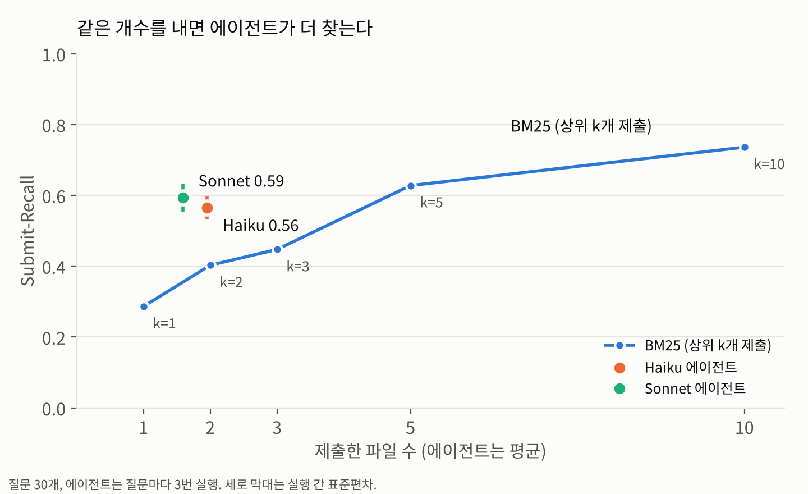

# agent-search-eval

Claude Code처럼 Grep·Glob·Read로 파일을 찾아가는 에이전트가, 단어 검색 한 번(BM25)보다 "고쳐야 할 파일"을 더 잘 찾는지 재 본 실험입니다. 질문과 정답은 개인 공개 리포의 커밋 기록으로 만들었습니다.



## 결과 (질문 30개, 2026-11-11)

| arm | Submit-Recall | Precision | 평균 제출 수 | input 토큰 합계 (중앙값) |
|---|---|---|---|---|
| BM25 상위 5개 | 0.628 | 0.262 | 4.77 (최대 5) | - |
| BM25 상위 2개 | 0.403 | - | 2 | - |
| Grep 에이전트 (Haiku 5.5) | 0.565 ± 0.032 | 0.594 | 1.96 | 98,676 |
| Grep 에이전트 (Sonnet 5.5) | 0.594 ± 0.040 | 0.659 | 1.59 | 51,382 |

± 는 실행 3번의 실행별 평균이 흔들린 폭(표준편차)입니다. 짝 비교(질문 단위, 부트스트랩 95% 구간):

| 비교 | Haiku | Sonnet |
|---|---|---|
| 에이전트 − BM25 상위 5개 | −0.063 [−0.191, +0.074] | −0.034 [−0.151, +0.091] |
| 에이전트 − BM25 같은 개수 | +0.160 [+0.029, +0.296] | +0.244 [+0.106, +0.398] |

1. BM25가 5개를 내면 Submit-Recall 차이는 구간이 0을 포함해서, 어느 쪽이 이겼다고 말할 수 없습니다.
2. BM25도 에이전트가 낸 개수만큼만 내게 하면 에이전트가 더 찾습니다. 두 모델 모두 구간이 0 위에 있습니다.
3. 에이전트는 평균 1.6~2개만 냅니다. 정답이 2개 이상인 질문 19개에서는 BM25 상위 5개(0.623)보다 낮았습니다(Haiku 0.523, Sonnet 0.499).
4. 정답 파일을 처음 읽기 직전 검색어 가운데 질문에 있던 단어만 쓴 경우는 Haiku 12/107, Sonnet 11/79뿐입니다. 나머지는 앞선 결과에서 본 단어(obs: 48, 20)나 질문에도 결과에도 없던 단어(guess: 42, 47)였습니다. 질문은 한국어, 코드는 영어라 모델이 단어를 바꿔 넣는 경우가 많았습니다.
5. Sonnet은 Haiku보다 Read를 덜 썼고(192번 vs 381번) 토큰도 절반 정도였습니다. 맞힌 91건 중 16건은 파일을 열지 않고 grep 결과 줄만 보고 냈습니다. 그래서 Read 도구 기준 Read-Recall(0.490)이 Submit-Recall보다 낮게 나옵니다.

## 설계

- 대상 리포: [should-i-still-hold-this-stock](https://github.com/deokjinlog/should-i-still-hold-this-stock), [can-this-be-redeveloped](https://github.com/deokjinlog/can-this-be-redeveloped)
- 질문: 커밋 하나가 질문 하나. 커밋 제목에서 `feat(scope):` 같은 앞머리를 뗀 문장입니다. 후보 85개에서 리포 비율대로 30개를 뽑았습니다(시드 20261111).
- 정답(골든셋): 그 커밋이 수정한 코드 파일. 테스트·문서·데이터와 새로 만든 파일은 뺍니다. 질문당 1~4개.
- 기준 시점: 부모 커밋을 `git archive`로 푼 스냅샷. `.git`이 없어서 에이전트가 미래 커밋을 볼 수 없습니다.
- 질문 속성(결과를 보기 전에 붙임): 질문에 기준 시점 코드와 같은 영문 단어가 있는가. 30개 중 7개입니다.

| arm | 하는 일 | 제출 |
|---|---|---|
| BM25 | 질문으로 코드 파일(테스트 제외) 순위를 매김. 한국어는 글자 2-gram, 코드 이름은 snake_case·camelCase를 쪼갬. k1=1.5, b=0.75 | 상위 k개 |
| Grep 에이전트 | Claude Code 헤드리스(`claude -p`). 도구는 Grep·Glob·Read만, 최대 30턴, 질문마다 3번 실행 | 마지막 JSON 배열 |

에이전트 실행은 바깥 환경과 섞이지 않게 격리했습니다: `--strict-mcp-config`, `--setting-sources project`, `--no-session-persistence`, 브라우저 MCP 차단, 메모리·플러그인·추가 폴더 환경변수 제거. 실행 기록은 채점에 필요한 이벤트만 `runs/<model>/<qid>/r<n>.jsonl.gz`에 남깁니다.

지표 정의(Submit-Recall, Read-Recall, Precision, input 토큰 합계·최대값, 검색어 출처)는 [평가 지표 글](https://deokjin-dev.tistory.com/26)과 `ase/score.py` 주석에 있습니다. 검색어 출처는 이 실험에서 guess(질문에도 앞선 결과에도 없던 단어)를 하나 더 나눴습니다.

## 한계

- 질문 30개, 한 사람이 쓴 리포 2개입니다. 일반화하기 어렵습니다.
- 질문이 커밋 제목 한 줄이라 실제 이슈보다 정보가 적고, 고친 뒤에 쓴 문장입니다.
- Vector RAG arm이 없습니다. 실험 환경에 임베딩 모델이 없어 의미 검색은 비교하지 못했습니다.
- BM25는 형태소 분석 없이 2-gram으로 잘랐습니다.
- 비용은 Claude Code가 계산한 추정값(`total_cost_usd`)입니다. 구독 사용량과 같지 않습니다. 90번 실행 합계 Haiku $0.63, Sonnet $5.45.
- 실행이 질문당 3번이라 흔들림 추정이 거칩니다.

## 다시 돌리기

```bash
# 대상 리포를 ../deokjinlog/ 아래에 clone 해 둔다
python -m ase.golden --repo ../deokjinlog/should-i-still-hold-this-stock --repo ../deokjinlog/can-this-be-redeveloped -o data/golden_candidates.jsonl
python -m ase.sample                       # → data/golden.jsonl (30개)
python -m ase.bm25                         # → results/bm25.jsonl
python -m ase.agent --model haiku --runs 3 # Claude Code 로그인 필요, → runs/haiku/
python -m ase.score --model haiku          # → results/agent_haiku.jsonl
python -m ase.report --models haiku sonnet # → results/summary.json
python -m ase.chart                        # → results/recall_vs_submitted.png
python -m pytest -q
```
