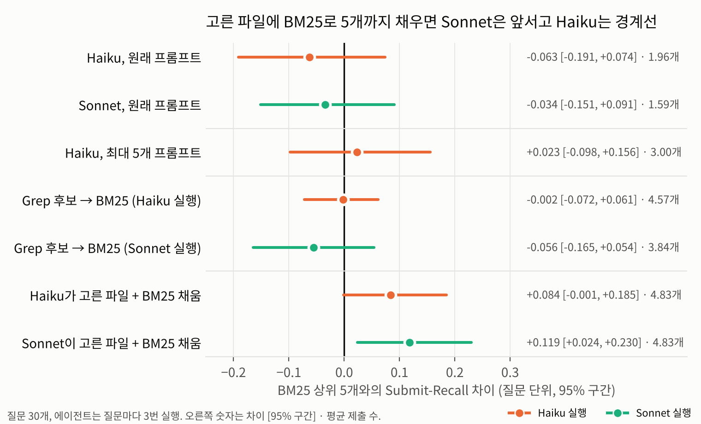

# agent-search-eval

Claude Code처럼 Grep·Glob·Read로 파일을 찾아가는 에이전트가, 단어 검색 한 번(BM25)보다 "고쳐야 할 파일"을 더 잘 찾는지 재 본 실험입니다. 질문과 정답은 개인 공개 리포의 커밋 기록으로 만들었습니다. 해설 글: [Grep 에이전트는 BM25보다 고칠 파일을 잘 찾을까](https://deokjin-dev.tistory.com/33)


## 결과 (질문 30개, 2026-11-11)

| arm | Submit-Recall | Precision | 평균 제출 수 | input 토큰 합계 (중앙값) |
|---|---|---|---|---|
| BM25 상위 5개 | 0.628 | 0.262 | 4.77 (최대 5) | - |
| BM25 상위 2개 | 0.403 | - | 2 | - |
| Grep 에이전트 (Haiku 5.5) | 0.565 ± 0.032 | 0.594 | 1.96 | 98,676 |
| Grep 에이전트 (Sonnet 5.5) | 0.594 ± 0.040 | 0.659 | 1.59 | 51,382 |

± 는 실행 3번의 실행별 평균이 흔들린 폭(표준편차)입니다. 짝 비교(질문 단위, 부트스트랩 95% 구간):

| 비교 | Haiku | Sonnet |
|---|---|---|
| 에이전트 − BM25 상위 5개 | −0.063 [−0.191, +0.074] | −0.034 [−0.151, +0.091] |
| 에이전트 − BM25 같은 개수 | +0.160 [+0.029, +0.296] | +0.244 [+0.106, +0.398] |

1. BM25가 5개를 내면 Submit-Recall 차이는 구간이 0을 포함해서, 어느 쪽이 이겼다고 말할 수 없습니다.
2. BM25도 에이전트가 낸 개수만큼만 내게 하면 에이전트가 더 찾습니다. 두 모델 모두 구간이 0 위에 있습니다.
3. 에이전트는 평균 1.6~2개만 냅니다. 정답이 2개 이상인 질문 19개에서는 BM25 상위 5개(0.623)보다 낮았습니다(Haiku 0.523, Sonnet 0.499).
4. 정답 파일을 처음 읽기 직전 검색어 가운데 질문에 있던 단어만 쓴 경우는 Haiku 12/107, Sonnet 11/79뿐입니다. 나머지는 앞선 결과에서 본 단어(obs: 48, 20)나 질문에도 결과에도 없던 단어(guess: 42, 47)였습니다. 질문은 한국어, 코드는 영어라 모델이 단어를 바꿔 넣는 경우가 많았습니다.
5. Sonnet은 Haiku보다 Read를 덜 썼고(192번 vs 381번) 토큰도 절반 정도였습니다. 맞힌 91건 중 16건은 파일을 열지 않고 grep 결과 줄만 보고 냈습니다. 그래서 Read 도구 기준 Read-Recall(0.490)이 Submit-Recall보다 낮게 나옵니다.
6. (결과를 본 뒤 추가한 지표) 정답 파일 경로가 Grep 결과에 한 번이라도 나온 비율(Grep-Recall)은 Haiku 0.854, Sonnet 0.709였습니다. 실행 하나에서 Grep이 보여 준 파일 수 중앙값은 Haiku 25개, Sonnet 10개입니다. 정답 파일을 "Grep 결과에 떴는가 × 제출했는가"로 나누면(아래 두 번째 표), 놓친 몫 가운데 Grep에 떴는데 내지 않은 몫이 Haiku 0.311, Sonnet 0.216이고, Grep에 한 번도 뜨지 않은 몫이 0.124, 0.191입니다. Haiku는 주로 고르는 단계에서 놓쳤고, Sonnet은 검색과 고르기에서 비슷하게 놓쳤습니다.

| 단계 | Haiku | Sonnet |
|---|---|---|
| Grep 결과에 정답이 나옴 (Grep-Recall) | 0.854 | 0.709 |
| 정답 파일을 Read로 엶 (Read-Recall) | 0.661 | 0.490 |
| 정답 파일을 제출함 (Submit-Recall) | 0.565 | 0.594 |

| 정답 파일 (질문·실행 평균, 네 줄 합 1) | Haiku | Sonnet |
|---|---|---|
| Grep에 뜨고 제출함 | 0.543 | 0.494 |
| Grep 밖에서 찾아 제출함 | 0.022 | 0.100 |
| Grep에 떴지만 제출 안 함 (고르기에서 놓침) | 0.311 | 0.216 |
| Grep에 안 뜨고 제출도 안 함 (검색에서 놓침) | 0.124 | 0.191 |

첫째·둘째 줄의 합이 Submit-Recall, 첫째·셋째 줄의 합이 Grep-Recall입니다(`ase/report.py`의 `gold_split`, 반올림 때문에 0.001 어긋날 수 있음).

## 후속 실험: 고르는 단계를 바꾸면 (5주차, 결과를 보기 전에 적음)

위 결과에서 Haiku는 Grep 결과에 뜬 정답을 내지 않아 놓친 몫(0.311)이 컸습니다. 그래서 찾는 과정은 그대로 두고 고르는 단계만 바꾼 arm 세 개를 BM25 상위 5개와 비교합니다(`ase/followup.py`).

| arm | 하는 일 | 새 호출 |
|---|---|---|
| haiku-upto5 | 프롬프트에 "고쳐야 할 파일이 여러 개일 수 있습니다. 가능성이 높은 순서대로 최대 5개까지 냅니다." 한 줄만 더함. 나머지 설정은 위와 같음 | Haiku 90번 |
| grep→BM25 | 위 실행(Haiku, Sonnet)에서 Grep 결과에 경로로 나온 코드 파일만 후보로 두고 질문 BM25 점수 순으로 최대 5개 | 없음 |
| 에이전트+채움 | 에이전트가 낸 파일(최대 5개)을 앞에 두고, 모자란 만큼 grep→BM25 순서, 그다음 저장소 전체 BM25 순서로 5개를 채움 | 없음 |

- 주 지표: Submit-Recall. BM25 상위 5개와 질문 단위 짝 비교, 부트스트랩 95% 구간(위와 같은 시드).
- 보조 지표: Precision, 평균 제출 수, 정답이 2개 이상인 질문 19개의 Submit-Recall, haiku-upto5와 원래 Haiku의 짝 비교.
- 실행 전에 적은 예상: haiku-upto5는 제출 수가 늘어 원래 Haiku보다 Submit-Recall이 오를 것. 에이전트+채움은 같은 5개를 내는 BM25 상위 5개보다 높을 것. 틀리면 틀린 대로 적습니다.

```bash
python -m ase.agent --model haiku --variant upto5 --runs 3   # → runs/haiku-upto5/
python -m ase.score --model haiku-upto5
python -m ase.followup                                       # → results/followup.json
python -m ase.chart_followup                                 # → results/followup_vs_bm25.png
```

### 후속 실험 결과 (2026-11-11, results/followup.json)



| arm | Submit-Recall | Precision | 평균 제출 수 | − BM25 상위 5개 (95% 구간) |
|---|---|---|---|---|
| BM25 상위 5개 | 0.628 | 0.262 | 4.77 | - |
| Haiku (위 실행) | 0.565 | 0.594 | 1.96 | −0.063 [−0.191, +0.074] |
| haiku-upto5 | 0.651 | 0.468 | 3.00 | +0.023 [−0.098, +0.156] |
| grep→BM25 (Haiku 실행) | 0.626 | 0.266 | 4.57 | −0.002 [−0.072, +0.061] |
| grep→BM25 (Sonnet 실행) | 0.572 | 0.300 | 3.84 | −0.056 [−0.165, +0.054] |
| 에이전트+채움 (Haiku) | 0.712 | 0.278 | 4.83 | +0.084 [−0.001, +0.185] |
| 에이전트+채움 (Sonnet) | 0.746 | 0.287 | 4.83 | +0.119 [+0.024, +0.230] |

1. haiku-upto5는 원래 Haiku보다 Submit-Recall이 +0.086 [+0.009, +0.174] 올랐습니다(질문별 이김 7, 비김 19, 짐 4). 평균 제출 수는 1.96개에서 3.00개로 늘고 Precision은 0.594에서 0.468로 내려갔습니다. BM25 상위 5개와의 차이는 여전히 구간이 0을 포함합니다. 추정 비용은 90번 합계 $0.59로 원래 Haiku($0.63)와 비슷했습니다.
2. Grep 결과에 뜬 후보를 BM25 점수로 다시 고르기만 하면 BM25 상위 5개와 거의 같았습니다. 후보는 실행당 평균 Haiku 20.3개, Sonnet 11.7개였습니다.
3. 에이전트가 낸 파일을 앞에 두고 BM25 순서로 5개까지 채우면 BM25 상위 5개보다 높았습니다. Sonnet은 구간이 0 위에 있고, Haiku는 구간 하한이 −0.001이라 0을 겨우 포함합니다. 실행 전 예상은 Sonnet에서만 맞았습니다.
4. haiku-upto5의 정답 나눔은 Grep에 떴지만 안 냄 0.254(원래 0.311), Grep에 안 뜨고 안 냄 0.095(원래 0.124)였습니다.
5. 같은 30문항으로 arm 여러 개를 비교했으므로, 구간이 0을 겨우 넘거나 겨우 포함하는 결과는 약한 근거로 봐야 합니다.

## 후속 실험 2: 한국어 질문을 영어 코드와 잇기 (결과를 보기 전에 적음, 2026-11-12)

한국어로만 쓴 질문 23개에서는 BM25 상위 5개 0.536, Haiku 0.498, Sonnet 0.528로 모두 낮았습니다. 질문은 한국어, 코드는 영어라 겹치는 단어가 없기 때문으로 봅니다. 이 간극을 메우는 두 방법을 BM25 상위 5개(`results/bm25.jsonl`)와 비교합니다(`ase/followup2.py`).

| arm | 하는 일 | 새 호출 | 상태 |
|---|---|---|---|
| rewrite-haiku (주 arm) | Haiku가 질문만 보고 코드에 나올 법한 영어 식별자·키워드 10~20개를 추측. BM25 질문 = 원래 질문 + 추측한 단어, 상위 5개. 도구 없음(`--tools ""`), 빈 임시 폴더, 에이전트 arm과 같은 격리 플래그. 질문마다 3번 | Haiku 90번 (도구 없는 한 턴) | 이 환경에서 실행 |
| vector | 다국어 임베딩 BAAI/bge-m3(dense). 파일을 60줄 창, 40줄 간격으로 자르고 조각마다 파일 경로를 붙임. 파일 점수 = 조각 코사인 유사도 최댓값, 상위 5개 | 없음 (로컬 임베딩) | 대기: 이 환경에 모델이 없고 내려받기가 막혀 있음 |
| hybrid (보조) | BM25 순위와 vector 순위를 RRF(k=60)로 합쳐 상위 5개 | 없음 | vector와 함께 |

- 주 지표: 한국어로만 쓴 23문항의 Submit-Recall, BM25 상위 5개와 질문 단위 짝 비교, 부트스트랩 95% 구간(위와 같은 시드). 30문항 전체도 같이 적습니다.
- 질문 속성(has_identifier)은 4주차 실험 전에 붙인 것을 그대로 씁니다.
- 실행 전에 적은 예상:
  1. rewrite-haiku는 한국어로만 쓴 23문항에서 BM25 상위 5개보다 높을 것(구간이 0 위).
  2. rewrite-haiku는 영문 단어가 있는 7문항에서는 차이가 작을 것(이미 0.929).
  3. vector는 한국어로만 쓴 23문항에서 BM25 상위 5개보다 높을 것.
  4. hybrid는 30문항 전체에서 BM25 상위 5개보다 높을 것.
- 비용은 rewrite-haiku만 Claude Code 추정 비용 합계로 적습니다(`results/rewrite_haiku_cost.json`).

```bash
python -m ase.rewrite --model haiku --runs 3   # → results/rewrite_haiku.jsonl
pip install sentence-transformers              # 네트워크가 되는 곳에서
python -m ase.vector --model BAAI/bge-m3       # → results/vector.jsonl, results/hybrid.jsonl
python -m ase.followup2                        # → results/followup2.json
```

### 후속 실험 2 결과: 질문 재작성 (2026-11-12, results/followup2.json)

| 질문 | n | BM25 상위 5개 | rewrite-haiku | 차이 (95% 구간) | 질문별 이김·비김·짐 |
|---|---|---|---|---|---|
| 한국어로만 쓴 질문 | 23 | 0.536 | 0.530 | −0.006 [−0.143, +0.150] | 5 · 10 · 8 |
| 영문 단어가 있는 질문 | 7 | 0.929 | 0.825 | −0.103 [−0.206, −0.024] | 0 · 4 · 3 |
| 전체 | 30 | 0.628 | 0.599 | −0.029 [−0.137, +0.094] | 5 · 14 · 11 |

1. 예상 1은 틀렸습니다. 한국어로만 쓴 23문항에서 영어 식별자를 추측해 더해도 BM25 상위 5개의 Submit-Recall은 그대로였습니다. 좋아진 질문 5개, 나빠진 질문 8개로 엇갈렸습니다.
2. 예상 2도 틀렸습니다. 차이가 작을 거라고 봤는데, 영문 단어가 있는 7문항에서는 오히려 내려갔고 구간이 0 아래에 있습니다. 질문에 이미 있던 코드 단어가 추측한 단어 10~20개에 묻힌 것으로 봅니다(해석).
3. 실행 3번의 평균은 0.592, 0.600, 0.606으로 거의 흔들리지 않았습니다. Precision 0.226, 평균 제출 4.80개. 추정 비용은 90번 합계 $0.028입니다.
4. (사후 진단, 구간 계산 안 함) 한국어로만 쓴 23문항에서 Recall@1은 0.250 → 0.302, Recall@3은 0.380 → 0.464로 올랐지만 Recall@5는 0.536 → 0.530이었습니다. 추측한 단어가 순위 위쪽을 바꾸기는 해도, 상위 5개 밖에 있던 정답을 끌어오지는 못했습니다.
5. vector, hybrid(예상 3, 4)는 아직 돌리지 않았습니다.

## 격리 점검 (`ase/isolation_probe.py`)

에이전트 실행 전에, 같은 한 마디 질문을 격리 수준만 바꿔 헤드리스로 돌리고 `system/init`에 실린 것을 셉니다(Claude Code 2.1.322, Chrome 연동이 켜진 클라우드 세션 안에서 실행). 결과는 `results/isolation_probe.json`.

| 설정 | 도구 (MCP) | MCP 서버 | 플러그인 | 스킬 | stream_event | input 토큰 |
|---|---|---|---|---|---|---|
| A 아무것도 안 함 | 64 (20) | 1 | 5 | 41 | 7 | 41,784 |
| B `--tools Grep,Glob,Read`만 | 23 (20) | 1 | 5 | 41 | 7 | 17,938 |
| C B + `--strict-mcp-config --setting-sources project --no-session-persistence` | 23 (20) | 1 | 5 | 22 | 7 | 17,931 |
| D C + `--no-chrome` | 3 (0) | 0 | 5 | 21 | 7 | 6,372 |
| E C + `--disallowedTools "mcp__*"` | 3 (0) | 1 | 5 | 22 | 6 | 7,803 |
| F 실험 설정 (C + 크롬 MCP 거부 + 환경변수 제거) | 3 (0) | 0 | 5 | 21 | 0 | 6,375 |

- `--tools`는 MCP 도구를 막지 않고, `--strict-mcp-config`는 내장 Chrome 연동을 막지 않습니다. 실험 설정(F)은 환경변수 제거와 거부 규칙으로 막았고, 문서에 있는 방법은 `--no-chrome`입니다.
- 부분 메시지(stream_event)는 부모 세션에서 넘어온 환경변수 때문에 켜져 있었고, 환경변수를 빼야 꺼졌습니다.
- 환경에 깔린 플러그인 5개는 어떤 설정에서도 남았습니다. 도구가 3개뿐이라 스킬을 부를 도구는 없지만, 완전한 격리는 아닙니다. `--bare`는 플러그인을 건너뛰지만 구독 로그인을 쓰지 않아 이 실험에서는 쓰지 않았습니다.

## 설계

- 대상 리포: [should-i-still-hold-this-stock](https://github.com/deokjinlog/should-i-still-hold-this-stock), [can-this-be-redeveloped](https://github.com/deokjinlog/can-this-be-redeveloped)
- 질문: 커밋 하나가 질문 하나. 커밋 제목에서 `feat(scope):` 같은 앞머리를 뗀 문장입니다. 후보 85개에서 리포 비율대로 30개를 뽑았습니다(시드 20261111).
- 정답(골든셋): 그 커밋이 수정한 코드 파일. 테스트·문서·데이터와 새로 만든 파일은 뺍니다. 질문당 1~4개.
- 기준 시점: 부모 커밋을 `git archive`로 푼 스냅샷. `.git`이 없어서 에이전트가 미래 커밋을 볼 수 없습니다.
- 질문 속성(결과를 보기 전에 붙임): 질문에 기준 시점 코드와 같은 영문 단어가 있는가. 30개 중 7개입니다.

| arm | 하는 일 | 제출 |
|---|---|---|
| BM25 | 질문으로 코드 파일(테스트 제외) 순위를 매김. 한국어는 글자 2-gram, 코드 이름은 snake_case·camelCase를 쪼갬. k1=1.5, b=0.75 | 상위 k개 |
| Grep 에이전트 | Claude Code 헤드리스(`claude -p`). 도구는 Grep·Glob·Read만, 최대 30턴, 질문마다 3번 실행 | 마지막 JSON 배열 |

에이전트 실행은 바깥 환경과 섞이지 않게 격리했습니다: `--strict-mcp-config`, `--setting-sources project`, `--no-session-persistence`, 브라우저 MCP 차단, 메모리·플러그인·추가 폴더 환경변수 제거. 실행 기록은 채점에 필요한 이벤트만 `runs/<model>/<qid>/r<n>.jsonl.gz`에 남깁니다.

지표 정의(Submit-Recall, Read-Recall, Precision, input 토큰 합계·최대값, 검색어 출처)는 [평가 지표 글](https://deokjin-dev.tistory.com/26)과 `ase/score.py` 주석에 있습니다. 검색어 출처는 이 실험에서 guess(질문에도 앞선 결과에도 없던 단어)를 하나 더 나눴습니다.

## 한계

- 질문 30개, 한 사람이 쓴 리포 2개입니다. 일반화하기 어렵습니다.
- 질문이 커밋 제목 한 줄이라 실제 이슈보다 정보가 적고, 고친 뒤에 쓴 문장입니다.
- Vector RAG arm이 없습니다. 실험 환경에 임베딩 모델이 없어 의미 검색은 비교하지 못했습니다.
- BM25는 형태소 분석 없이 2-gram으로 잘랐습니다.
- 비용은 Claude Code가 계산한 추정값(`total_cost_usd`)입니다. 구독 사용량과 같지 않습니다. 90번 실행 합계 Haiku $0.63, Sonnet $5.45.
- 실행이 질문당 3번이라 흔들림 추정이 거칩니다.

## 관련 연구 (2026-11-12 추가)

이슈를 보고 고칠 파일을 찾는 문제(code localization)는 영어 벤치마크에서 더 큰 규모로 이미 쟀습니다. 이 리포의 숫자와는 질문 언어, 정답 파일 수, 지표가 달라 바로 비교할 수 없습니다.

| 연구 | 데이터 | 결과 |
|---|---|---|
| [LocAgent](https://arxiv.org/abs/2503.09089) (Chen 외, 2025) | SWE-Bench-Lite 274문제(정답 파일 1개), 파일 단위 Acc@5(%) | BM25 61.68, 코드 임베딩 CodeRankEmbed 84.67, SWE-agent·OpenHands(Claude 3.5) 90.15, LocAgent(Claude 3.5) 94.16 |
| [Improving agent with semantic search](https://cursor.com/blog/semsearch) (Cursor, 2025) | 자체 벤치마크 Cursor Context Bench | grep에 의미 검색을 더하자 정확도가 평균 12.5% 높았고(모델별 6.5~23.5%), 둘을 같이 쓸 때 가장 좋았음 |
| [Reformulate, Retrieve, Localize](https://arxiv.org/abs/2512.07022) (Caumartin, Melo) | Long Code Arena 버그 위치 찾기 | 버그 리포트에서 식별자와 코드 조각을 뽑아 다시 쓴 질문으로 BM25 Hit@1 0.320 → 0.447 |
| [Is Grep All You Need?](https://arxiv.org/abs/2605.15184) (Sen 외, 2026) | LongMemEval 116문제(대화 기록, 코드 아님) | grep이 대체로 벡터 검색보다 높았고, 같은 데이터라도 하네스(Claude Code, Codex, Gemini CLI 등)에 따라 점수가 크게 달라짐 |

이 리포가 따로 본 것은 한국어로 쓴 짧은 질문(커밋 제목)과 영어 코드 사이의 차이입니다. 질문에 코드와 같은 영문 단어가 있는 7개에서는 BM25 상위 5개가 0.929, 한국어로만 쓴 23개에서는 0.536이었습니다. 위 연구에서 코드 임베딩이 BM25보다 높았던 만큼, 빠진 Vector RAG arm이 이 리포의 결론을 바꿀 수 있습니다.

## 다시 돌리기

```bash
# 대상 리포를 ../deokjinlog/ 아래에 clone 해 둔다
python -m ase.golden --repo ../deokjinlog/should-i-still-hold-this-stock --repo ../deokjinlog/can-this-be-redeveloped -o data/golden_candidates.jsonl
python -m ase.sample                       # → data/golden.jsonl (30개)
python -m ase.bm25                         # → results/bm25.jsonl
python -m ase.agent --model haiku --runs 3 # Claude Code 로그인 필요, → runs/haiku/
python -m ase.score --model haiku          # → results/agent_haiku.jsonl
python -m ase.report --models haiku sonnet # → results/summary.json
python -m ase.chart                        # → results/recall_vs_submitted.png
python -m pytest -q
```
